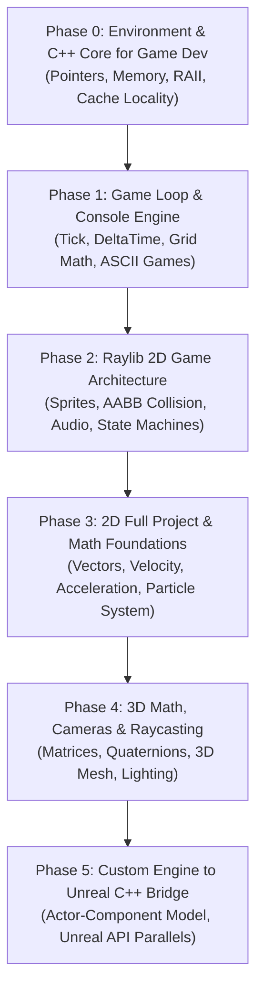

# 🎮 Game Development Mastery Roadmap (Web Dev to Unreal C++)

> **Student Profile**: Full-Stack Web Developer  
> **Ultimate Destination**: Unreal Engine 5/6 C++ Game Developer  
> **Current Hardware**: Intel Core i5 (10th Gen), Intel UHD Graphics (Lightweight & optimized workflow required)  
> **Target Toolchain**: C++17, MinGW-w64, Raylib (2D/3D), Custom Engine Architecture  
> **Last Updated**: 2026-10-01  

---

## 📌 Critical Protocol: How AI Teachers / Sessions Must Continue

> **To Any Future AI Assistant / Antigravity Agent:**  
> 1. Read this file first (`ROADMAP_AND_PROGRESS.md`).
> 2. Look at the **[Current Progress Tracker](#-current-progress-tracker)** below to see the exact Phase and Lesson in progress.
> 3. Check the respective project directory for the student's code and tests.
> 4. Do **not** skip ahead to heavy engines; adhere to the incremental, hands-on, step-by-step teaching style.
> 5. Update this file whenever a milestone or module is completed.
> 6. **Student writes `int main()`**: Do NOT pre-fill complete test suites in `main()`. Give clear requirements and expected behaviors, but leave `int main()` empty for the student to write from scratch so they master end-to-end program flow and debugging.

---

## 🗺️ Master Curriculum: The 5-Phase Journey



---

## 🔄 The Web Dev ➡️ Game Dev Mindset Translation

| Web Development Concept | Game Development Equivalent | Key Difference & Gotcha |
| :--- | :--- | :--- |
| **Event Loop (Browser / Node)** | **Game Loop (`Tick / Update / Render`)** | Web waits for events (reactive). Games run actively at fixed/variable rates 60-144 times every second. |
| **DOM / HTML Elements** | **Entity / Scene Graph / Framebuffer** | No DOM tree or CSS engine. You clear pixels and draw raw primitives/sprites each frame. |
| **CSS Flexbox / Box Model** | **Transforms (`Position, Rotation, Scale`) & AABB** | Coordinates are cartesian (usually $X$ right, $Y$ down in 2D screens, or $Y$ up / $Z$ up in 3D). |
| **Garbage Collection (JS/V8)** | **Manual Memory / RAII / Smart Pointers** | Game frames must not stutter. Memory allocations on the heap during the frame loop cause frame drops. |
| **Redux / State Management** | **Game State Machine & Component Systems** | State is held directly in contiguous data structures for high cache locality (ECS / Actor Components). |
| **`setTimeout` / `requestAnimationFrame`** | **`deltaTime` Accumulator** | Movement is measured in units per second: $\text{position} += \text{velocity} \times \Delta t$. |

---

## 📊 Current Progress Tracker

- **Current Active Phase**: **Phase 0: Environment Setup & C++ Foundations for Game Dev**
- **Current Active Lesson**: **Lesson 0.4 - Structs, Classes & Header Separation (`.h` / `.hpp` vs `.cpp`, compile units)**
- **Status**: 🚀 In Progress

### Detailed Milestone Checklist

#### Phase 0: C++ Essentials for Web Developers
- [x] **0.0: Toolchain Setup** (MinGW-w64 `g++` configured in User PATH, C++17 verified)
- [x] **0.1: Memory, Pointers & References** (Stack vs Heap, pointer arithmetic, dereferencing)
- [x] **0.2: RAII & Modern Smart Pointers** (`std::unique_ptr`, `std::shared_ptr`, avoiding memory leaks)
- [x] **0.3: Data Structures & Cache Locality** (Why `std::vector` rules game dev, avoiding pointer chasing)
- [ ] **0.4: Structs, Classes & Header Separation** (`.h` / `.hpp` vs `.cpp`, compile units)

#### Phase 1: The Core Game Loop & Console Engine
- [ ] **1.1: The Holy Trinity** (`ProcessInput()`, `Update(dt)`, `Render()`)
- [ ] **1.2: Fixed vs Variable Delta Time** (Understanding frame rate independence)
- [ ] **1.3: Project 1: Console ASCII Snake Game** (Grid math, directional vectors, collision logic)
- [ ] **1.4: Project 2: Space Invaders (Terminal)** (Bullet pools, bounding box collision, entity arrays)

#### Phase 2: Raylib 2D Game Architecture (Lightweight Visuals)
- [ ] **2.1: Raylib Setup & Window Management** (Hardware-accelerated 2D on Intel UHD)
- [ ] **2.2: Drawing & Coordinate Systems** (Textures, sprite sheets, camera 2D)
- [ ] **2.3: 2D Collision Detection** (AABB vs Circle vs Point collision math)
- [ ] **2.4: Project 3: Breakout / Pong Deluxe** (Ball physics, sound effects, particle sparkles)

#### Phase 3: Intermediate 2D Game Architecture
- [ ] **3.1: Vector Math for Games** (Vector2 operations, dot product, normalization, distance)
- [ ] **3.2: State Machines** (TitleScreen -> Playing -> Paused -> GameOver)
- [ ] **3.3: Animation & Tilemaps** (Sprite atlas parsing, grid collision layers)
- [ ] **3.4: Project 4: Top-Down Arena Roguelite** (Player, enemies, shooting, wave manager, loot)

#### Phase 4: 3D Math & Lightweight 3D (Raylib 3D)
- [ ] **4.1: 3D Vectors, Matrices & Quaternions** (Rotation matrices, pitch/yaw/roll)
- [ ] **4.2: 3D Cameras & Projections** (Perspective vs Orthographic, First-Person / Third-Person)
- [ ] **4.3: Raycasting & Picking** (Shooting a ray into 3D space to detect hits)
- [ ] **4.4: Project 5: 3D Dungeon Crawler / FPS Prototype** (Low-poly meshes, lighting, collision)

#### Phase 5: The Unreal Engine Bridge
- [ ] **5.1: Actor-Component Architecture** (How Raylib/Custom components map to `AActor` & `UActorComponent`)
- [ ] **5.2: Unreal's Memory Model** (`UObject`, `UPROPERTY`, Unreal Garbage Collector vs Raw C++)
- [ ] **5.3: Gameplay Framework in Unreal** (`GameMode`, `PlayerController`, `Pawn`, `Character`)
- [ ] **5.4: Blueprint to C++ Workflow** (Reading Unreal documentation, writing performant gameplay code)

---

## 📁 Repository Directory Structure

```text
game-dev-practice/
├── ROADMAP_AND_PROGRESS.md      <-- MASTER PROGRESS AND PROTOCOL (This file)
├── README.md                    <-- Quick workspace orientation
├── 00_setup_and_tooling/        <-- Build helper scripts (build.bat, run.ps1)
├── 01_cpp_foundations/          <-- Phase 0: C++ memory, pointers, structs
├── 02_console_games/            <-- Phase 1: Pure C++ Game Loop, Snake, Invaders
├── 03_raylib_2d/                <-- Phase 2 & 3: 2D games, physics, particles
├── 04_raylib_3d/                <-- Phase 4: 3D math, cameras, dungeon crawler
└── 05_engine_architecture/      <-- Phase 5: Actor-Component system & Unreal bridge
```

---

## 📝 Activity & Session Log

| Date | Lesson / Milestone | Summary of Achievements |
| :--- | :--- | :--- |
| 2026-10-01 | **Course Inception & Toolchain Setup** | Initialized master roadmap. Verified MinGW-w64 C++17 compiler (`g++`). Updated user PATH. Established web-to-game dev mapping. |
| 2026-10-05 | **Lesson 0.1: Memory, Pointers & References** | Successfully implemented addExperience (reference) and teleportPlayer (pointers & nullptr check) in exercise_01.cpp. Configured clangd/IntelliSense header include paths. |
| 2026-10-05 | **Lesson 0.2: RAII & Smart Pointers** | Implemented std::unique_ptr and std::shared_ptr in exercise_02.cpp. Mastered RAII scope lifetime mechanics and use_count decrement. |
| 2026-10-18 | **Lesson 0.3: Data Structures & Cache Locality** | Mastered std::vector memory reservation (avoiding heap allocations), reference-based updates in game loops, and the O(1) Swap & Pop pattern in exercise_03.cpp. |
